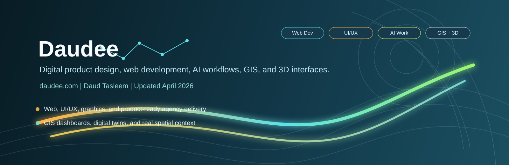

<!-- Use this README in the special daudee215/daudee215 profile repository. -->

  

<h1 align="center">Daud Tasleem</h1>

  GIS specialist building geospatial dashboards, digital twin prototypes, and 3D web interfaces.

  <a href="https://daudee.com">Website</a>
  |
  <a href="https://github.com/daudee215">GitHub</a>

  Most of my current build work lives in private repositories while I prepare cleaner public case studies and demo-ready showcases.

## Profile

I build geospatial products that help teams understand infrastructure, terrain, and operations faster. My work usually sits at the intersection of GIS, frontend engineering, 3D interfaces, and data workflow design.

## What I work on

- GIS-heavy web applications that turn spatial data into decision-ready dashboards.
- 2D and 3D interfaces using Cesium, Mapbox GL, Leaflet, and Three.js.
- End-to-end prototypes that connect ingestion, analysis, visualization, and reporting.
- Corridor-aware infrastructure tools for monitoring, inspection, and digital twin workflows.

## Focus areas

| Area | What that means in practice |
| --- | --- |
| Geospatial UI | Spatial dashboards, map interactions, layer control, terrain-aware views |
| 3D visualization | Cesium and Three.js experiences for digital twins and point-cloud review |
| Operational GIS | Hazard overlays, rail corridor context, inspection and field-support workflows |
| Full-stack prototyping | Node.js APIs, lightweight data models, reporting, and product-style delivery |

## Featured work

### ModelRAIL Pro

ModelRAIL Pro is a full-stack rail infrastructure monitoring prototype built around the real Ceva-Ormea corridor in Piemonte, Italy. It combines geospatial context, digital twin views, inspection workflow thinking, and auditable reporting into a single product surface.

- Five-stage pipeline from ingest to publish.
- GIS and InSAR fusion with live SSE updates.
- UAV planning, point-cloud visualization, and reporting.
- Role-based access, audit logging, and Railway deployment support.

**Tech:** `JavaScript` `Node.js` `Express` `SQLite` `Cesium` `Mapbox GL` `Leaflet` `Three.js`

## Current direction

- Rail corridor monitoring and digital twin workflows.
- Hazard overlays, InSAR analysis, and operational GIS products.
- Point-cloud review, infrastructure reporting, and data-to-UI prototype work.

## Selected stack

`JavaScript` `Node.js` `Express` `SQLite` `Cesium` `Mapbox GL` `Leaflet` `Three.js` `GeoJSON`

## Connect

- Website: [daudee.com](https://daudee.com)
- GitHub: [@daudee215](https://github.com/daudee215)
