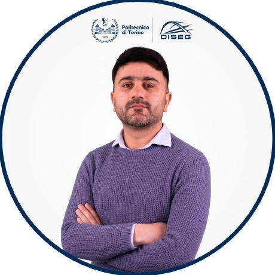

<!-- Use this README in the special daudee215/daudee215 profile repository. -->

  

<h1 align="center">Daud Tasleem</h1>

  

  Researcher at Politecnico di Torino (Polito), focused on GIS, GeoAI, BIM, infrastructure intelligence, natural hazards, and 3D digital twin workflows.

  <a href="https://daudee.com">Website</a>
  |
  <a href="https://github.com/daudee215">GitHub</a>

  Updated April 2026. Most current client and product work lives in private repositories while public case studies are being cleaned up for safer sharing.

## Profile

I build geospatial systems that help teams understand infrastructure, terrain, exposure, and operational risk. My work sits at the intersection of GIS, GeoAI, BIM, remote sensing, natural-hazard analysis, digital twins, and infrastructure monitoring.

The through-line is spatial intelligence: clear data pipelines, useful maps, 3D context, and decision-ready interfaces for complex built and natural environments.

## What I work on

- GIS and GeoAI workflows for spatial analysis, automation, and decision support.
- BIM and digital twin concepts for infrastructure monitoring and asset context.
- Natural-hazard overlays for landslide, flood, subsidence, climate, and exposure workflows.
- Remote sensing, point clouds, terrain data, and corridor-scale geospatial products.
- 2D/3D interfaces using Cesium, Mapbox GL, Leaflet, and Three.js.

## Focus areas

| Area | What that means in practice |
| --- | --- |
| GIS and GeoAI | Spatial analysis, automation, geospatial ML concepts, and decision support |
| BIM and digital twins | Infrastructure context, asset views, 3D scenes, and inspection workflows |
| Natural hazards | Landslide, flood, subsidence, climate, terrain, and exposure overlays |
| Infrastructure intelligence | Corridor monitoring, risk dashboards, reporting, and operational context |
| Geospatial interfaces | Spatial dashboards, map interactions, terrain-aware views, and 3D review |

## Featured work

### ModelRAIL Pro

ModelRAIL Pro is a full-stack rail infrastructure monitoring prototype built around the real Ceva-Ormea corridor in Piemonte, Italy. It turns spatial data, inspection thinking, natural-hazard context, and reporting into one product surface.

- Five-stage pipeline from ingest to publish.
- GIS and InSAR fusion with live SSE updates.
- UAV planning, point-cloud visualization, and reporting.
- Role-based access, audit logging, and Railway deployment support.

**Tech:** `JavaScript` `Node.js` `Express` `SQLite` `Cesium` `Mapbox GL` `Leaflet` `Three.js`

## Current direction

- GIS, GeoAI, BIM, and digital twin workflows for infrastructure intelligence.
- Natural-hazard context for rail, terrain, climate, and exposure analysis.
- Point-cloud review, remote sensing, and corridor-scale spatial products.
- Cleaner public case studies for geospatial engineering and risk workflows.

## Selected stack

`GIS` `GeoAI` `BIM` `Natural Hazards` `Remote Sensing` `Digital Twins` `JavaScript` `Node.js` `Cesium` `Mapbox GL` `Leaflet` `Three.js` `GeoJSON`

## Connect

- Website: [daudee.com](https://daudee.com)
- GitHub: [@daudee215](https://github.com/daudee215)
